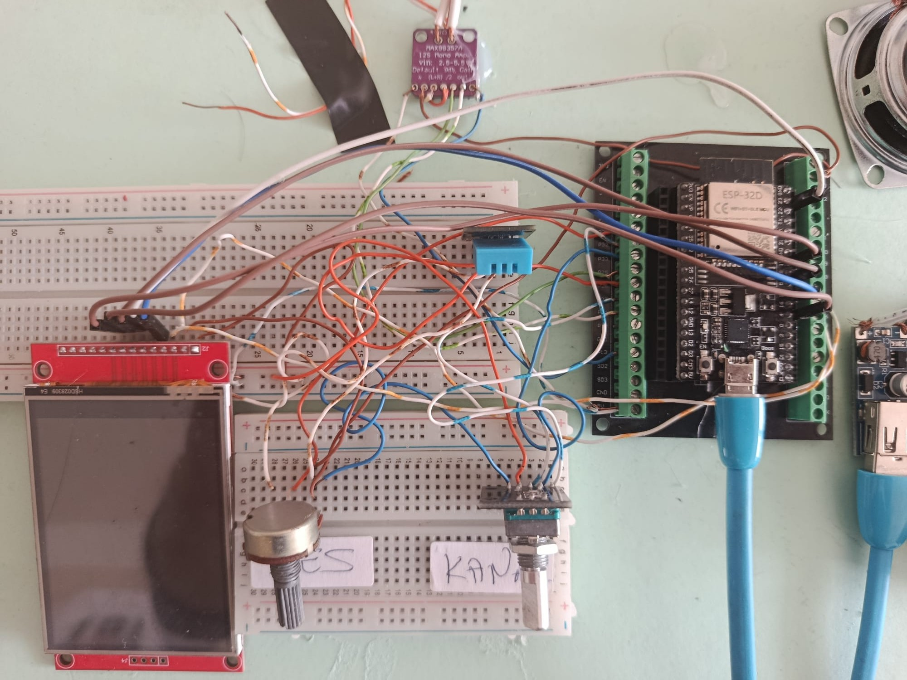
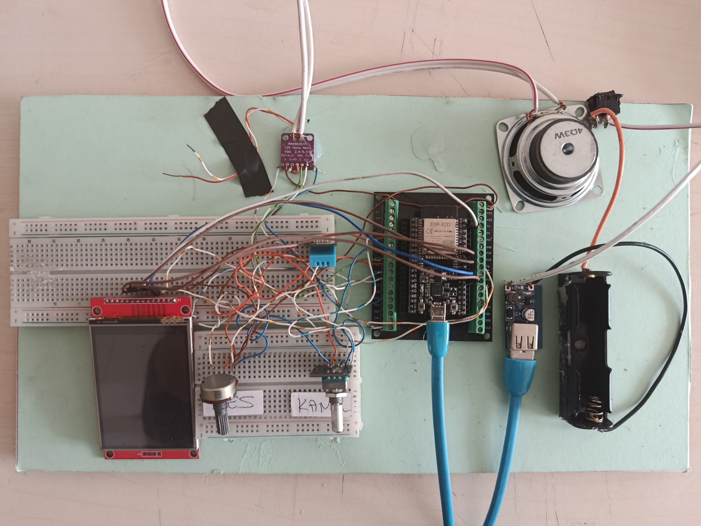
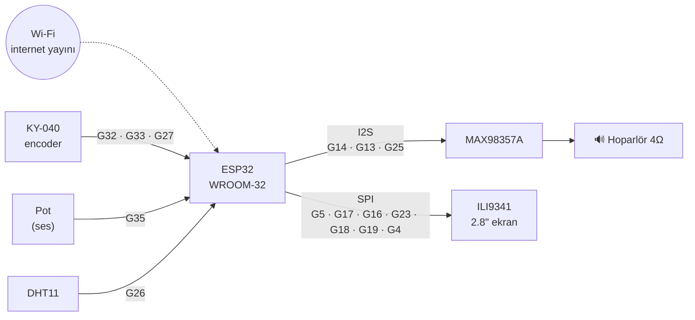

# ESP32 İnternet Radyosu 📻


[](https://www.youtube.com/@TA2CAY)

Tek bir ESP32 kartıyla yapılmış, radyo istasyonlarını Wi-Fi üzerinden çalan, renkli ekranlı,
hava durumu gösteren masaüstü internet radyosu.

<p align="center">
  
</p>

Ses, **MAX98357A** I2S dijital amfisiyle doğrudan hoparlöre verilir. Ayrıca DAC veya analog amfi gerekmez.
Kumanda tek bir döner düğmeyle (encoder) yapılır: **çevir = seç, bas = tamam**.

> 🎬 **Projenin yapımını adım adım videoda anlattım:** [youtube.com/@TA2CAY](https://www.youtube.com/@TA2CAY)
> Beğendiysen kanala abone olmayı unutma! 🔔

---

## İçindekiler

- [Özellikler](#özellikler)
- [Fotoğraflar](#fotoğraflar)
- [Ekran düzeni](#ekran-düzeni)
- [Malzeme listesi](#malzeme-listesi)
- [Bağlantı şeması](#bağlantı-şeması)
- [Kurulum](#kurulum)
- [Kullanım](#kullanım)
- [İstasyon listesi](#istasyon-listesi)
- [Hava durumu konumunu değiştirme](#hava-durumu-konumunu-değiştirme)
- [Yazılım nasıl çalışıyor?](#yazılım-nasıl-çalışıyor)
- [Sorun giderme](#sorun-giderme)
- [Proje yapısı](#proje-yapısı)
- [YouTube kanalı](#youtube-kanalı)
- [Lisans](#lisans)
- [English summary](#english-summary)

---

## Özellikler

**Radyo**
- MP3 ve AAC yayınları (HTTP ve HTTPS, `.pls` dahil)
- Kategorilere ayrılmış istasyonlar: Haber / Spor, Türkçe Pop, Slow, Halk / Özgün, Rock, Zonguldak
- İstasyon listesi kodun içinde değil, `data/stations.json` dosyasında. Kod değiştirmeden düzenlenebilir.
- Favoriler (★) ve Son Dinlenenler (son 10)
- Kapatıp açınca son dinlenen istasyondan devam eder
- Wi-Fi koparsa yayın, bağlantı geri gelince kendiliğinden yeniden başlar
- Hızlı çevirirken aradaki her istasyona bağlanmaz: düğme 1 saniye durunca seçilen istasyon çalar

**Ekran (ILI9341 2.8", 240×320, koyu tema)**
- NTP ile otomatik saat ve Türkçe tarih, Wi-Fi sinyal çubukları
- İstasyon adı, kategori, şehir, yayın biçimi ve bit hızı (örn. `AAC · 128 kbps`), tampon doluluk çubuğu
- **Şimdi çalıyor:** sanatçı ve şarkı ayrı satırlarda, sığmayan yazı kayar
- 8 bantlı **spektrum (VU) çubukları**, kategori renginde
- Türkçe harfli, kenarları yumuşatılmış fontlar. UTF-8 ve ISO-8859-9 (Latin-5) başlıklar doğru gösterilir.
- Gece 23:00–07:00 arası ekran ışığı otomatik kısılır

**Hava ve oda**
- **İçeri kartı:** DHT11 ile oda sıcaklığı ve nemi, bugünkü dinleme süresi ve şarkı sayısı
- **Dışarı kartı:** [Open-Meteo](https://open-meteo.com) ile anlık hava (simge + Türkçe açıklama) ve **3 günlük tahmin**. API anahtarı gerekmez.

---

## Fotoğraflar

| Devre (yakından) | Devrenin tamamı |
|---|---|
|  |  |

Breadboard üzerinde kurulu ilk sürüm: solda ekran, ses potu (SES) ve encoder (KANAL), ortada DHT11 ve
ESP32 (vidalı klemens adaptöründe), üstte MAX98357A amfi ve hoparlör, sağda pil + 5 V güç modülü.

---

## Ekran düzeni

```
┌──────────────────────────────────┐
│ 14:32     26 Ekim Pazartesi  ▂▄▆█ │  ← saat · tarih · Wi-Fi
│══════════════════════════════════│  ← kategori renginde çizgi
│▌ Kral Pop                     ★  │
│▌ (Türkçe Pop) 3/24     İstanbul  │  ← istasyon kartı
│▌ MP3 · 128 kbps          ▬▬▬▬▬   │  ← biçim · tampon
│                                  │
│ ŞİMDİ ÇALIYOR    ▂▅▇▆▄▃▂▁        │  ← spektrum
│ Sanatçı Adı                      │
│ Şarkının adı (sığmazsa kayar)    │
│                                  │
│ 🔈 ━━━━━━━━━━━━━──────────   12  │  ← ses seviyesi
│ ┌──────────────┐┌──────────────┐ │
│ │ İÇERİ        ││ DIŞARI    ☀  │ │
│ │     23°      ││     17°      │ │  ← dönen kartlar
│ │   Sıcaklık   ││    Açık      │ │
│ └──────────────┘└──────────────┘ │
└──────────────────────────────────┘
```

Alttaki kartlar kendiliğinden döner:
- **İçeri:** sıcaklık → nem → bugünkü dinleme (4 saniyede bir)
- **Dışarı:** şu an (8 s) → yarın → sonraki iki gün (4'er s)

---

## Malzeme listesi

| Parça | Adet | Not |
|---|---|---|
| ESP32-WROOM-32 DevKit (38 pin) | 1 | PSRAM gerekmez |
| MAX98357A I2S amfi modülü | 1 | 3 W, D sınıfı |
| Hoparlör 4 Ω, 3 W | 1 | |
| ILI9341 2.8" SPI TFT ekran (240×320) | 1 | Dokunmatikli model de olur, dokunmatik kullanılmıyor |
| KY-040 döner encoder (düğmeli) | 1 | |
| Potansiyometre (10 kΩ, lineer) | 1 | Ses ayarı |
| DHT11 sıcaklık/nem modülü (3 bacaklı) | 1 | Üzerinde pull-up direnci olan modül |
| 5 V 2 A USB adaptör | 1 | Bilgisayar USB'si yetmeyebilir |
| *(isteğe bağlı)* 18650 pil yuvası + 5 V USB çıkışlı yükseltici modül + anahtar | 1 | Kablosuz kullanım için |
| Breadboard, jumper kablolar | — | |

---

## Bağlantı şeması



| Modül | Modül pini | ESP32 | Not |
|---|---|---|---|
| **MAX98357A** | Vin | 5V (VIN) | Hoparlör akımı için 5 V |
| | GND | GND | |
| | BCLK | G14 | |
| | LRC | G13 | |
| | DIN | G25 | |
| | GAIN, SD | — | Boş (9 dB kazanç, mono L+R) |
| | +/− | Hoparlör | |
| **ILI9341** | VCC | 3V3 | |
| | GND | GND | |
| | CS | G5 | |
| | RESET | G16 | |
| | DC | G17 | |
| | SDI (MOSI) | G23 | |
| | SCK | G18 | |
| | LED | G4 | PWM ile parlaklık (gece kısılır) |
| | SDO (MISO) | G19 | |
| | T_CS | G15 | Dokunmatik kullanılmasa da bağlanmalı |
| **KY-040** | + | 3V3 | **5 V'a bağlama**, ESP32 girişleri 3,3 V'tur |
| | GND | GND | |
| | CLK | G32 | |
| | DT | G33 | |
| | SW | G27 | |
| **Potansiyometre** | Uçlar | 3V3 ve GND | |
| | Orta uç | G35 | ADC1 pini (Wi-Fi açıkken ADC2 okunamaz) |
| **DHT11 modülü** | S | G26 | |
| | + | 3V3 | |
| | − | GND | |

**Kullanılmaması gereken pinler:** G6–G11 (flash), G12 (açılışta flash voltajını belirler), G0/G2 (boot).

---

## Kurulum

### 1. Gerekli yazılım
- [VS Code](https://code.visualstudio.com/) + [PlatformIO](https://platformio.org/install/ide?install=vscode) eklentisi
- Kütüphaneler `platformio.ini`'de tanımlı, ilk derlemede **kendiliğinden** iner:
  - [ESP32-audioI2S](https://github.com/schreibfaul1/ESP32-audioI2S) 2.0.7 — yayın çözme ve I2S çıkışı
  - [TFT_eSPI](https://github.com/Bodmer/TFT_eSPI) — ekran
  - [ArduinoJson](https://arduinojson.org/) — istasyon listesi ve hava durumu
  - [DHT sensor library](https://github.com/adafruit/DHT-sensor-library) — sıcaklık/nem

### 2. Projeyi indir
```bash
git clone https://github.com/ta2cay/esp32-internet-radyo.git
cd esp32-internet-radyo
```

### 3. Wi-Fi bilgilerini gir
`include/secrets.example.h` dosyasını aynı klasöre **`secrets.h`** adıyla kopyala ve düzenle:
```cpp
constexpr char WIFI_SSID[] = "AG_ADI";
constexpr char WIFI_PASS[] = "SIFRE";
```
> `secrets.h` `.gitignore`'dadır. Şifren yanlışlıkla GitHub'a gitmez.

### 4. Yükle
Kartı USB ile bağla ve sırayla çalıştır:
```bash
pio run -t uploadfs   # istasyon listesi (data/stations.json) → kartın LittleFS alanı
pio run -t upload     # program
pio device monitor    # (isteğe bağlı) seri çıktıyı izle
```
VS Code'da aynı işler PlatformIO kenar çubuğundan yapılabilir: **Upload Filesystem Image** ve **Upload**.

> İstasyon listesini değiştirdiğinde yalnızca `uploadfs` yeterli, programı yeniden yüklemen gerekmez.

---

## Kullanım

Tek kural: **ÇEVİR = seç, BAS = tamam.** Uzun basma yok.

| Durum | Çevir | Bas |
|---|---|---|
| Radyo çalarken | Aynı kategoride önceki/sonraki istasyon (1 s durunca çalar) | Menüyü aç |
| Menüde | Satır seç | Seçili satırı aç |
| İstasyon listesinde | İstasyon seç | Çal ve menüyü kapat |

**Menü:**
```
◀ Kapat
★ Favoriye ekle / çıkar      (çalan istasyon)
★ Favoriler               4
◷ Son Dinlenenler        10
──────────────────────────
▶ Türkçe Pop             24   ← menü, çalan kategoride açılır
● Slow                   17
● Halk / Özgün           15
  ...
```
- Her listenin ilk satırı **◀ Geri**'dir.
- Menü açılınca imleç çalan kategorinin üzerindedir: **iki kez basmak** o kategorinin istasyon listesini açar.
- Menüde 10 saniye işlem yapılmazsa kendiliğinden kapanır.
- **Ses:** potansiyometre (0–21).

**Seri port komutları** (115200 baud, test için): `n` sonraki, `p` önceki istasyon, `c` sonraki kategori, `f` favori ekle/çıkar.

---

## İstasyon listesi

İstasyonlar `data/stations.json` dosyasındadır:

```json
{
  "categories": [
    {
      "name": "Türkçe Pop",
      "stations": [
        { "name": "Kral Pop", "url": "https://...", "city": "İstanbul" },
        { "name": "Radyo Viva", "url": "http://..." }
      ]
    }
  ]
}
```

- `city` isteğe bağlıdır, ekranda istasyon adının altında sağda görünür.
- Kategori rengi adından otomatik seçilir (`haber` mavi, `pop` turkuaz, `slow` pembe, `rock` kırmızı, `halk` turuncu...). Tanınmayan adlar sıradaki yedek rengi alır.
- Dosya okunamazsa kodun içindeki küçük yedek liste çalar.
- Listedeki tüm istasyonlar cihazda tek tek denenmiştir.

**Yeni istasyon bulma:** [radio-browser.info](https://www.radio-browser.info/) ve [fmstream.org](https://fmstream.org/) iyi kaynaklardır. Doğrudan MP3/AAC akış adresi gerekir.

> ⚠️ **HLS (`.m3u8`) yayınları çalmaz.** Bunlar için PSRAM'li bir kart (ESP32-WROVER) gerekir. TRT'nin bazı kanalları bu yüzden listede yok.

**Toplu deneme:** `src/main.cpp`'de `#define STATION_SCAN 1` yapılırsa açılışta her istasyon 15 saniye denenir ve seri porta `CALISIYOR` / `yok` raporu yazılır.

---

## Hava durumu konumunu değiştirme

Varsayılan konum **Çaycuma / Zonguldak**. Kendi şehrin için `src/main.cpp`'deki `WEATHER_URL` içinde enlem ve boylamı değiştir:

```cpp
constexpr char WEATHER_URL[] =
    "http://api.open-meteo.com/v1/forecast?latitude=41.4264&longitude=32.0756"
    ...
```

Koordinatları Google Haritalar'da konuma sağ tıklayarak bulabilirsin. Open-Meteo ücretsizdir ve API anahtarı gerektirmez.

---

## Yazılım nasıl çalışıyor?

ESP32'nin iki çekirdeği ve 320 KB RAM'i, aynı anda HTTPS yayın çözme, ekran ve hava durumu için dikkatli kullanılmalı. Öne çıkan kararlar:

| Konu | Çözüm |
|---|---|
| **Ses takılmaması** | `loop()` her turda `audio.loop()`'u çağırır. Ekran hiçbir zaman tamamen yeniden çizilmez: her bölgenin bir "kirli" bayrağı vardır ve bir turda **en fazla bir bölge** çizilir. |
| **Hava durumu** | Ayrı bir FreeRTOS görevinde, **çekirdek 0**'da çalışır. HTTP beklerken ses ve ekran donmaz. Veri `portMUX` kilidiyle paylaşılır. Yayın zaten bir TLS bağlantısı tuttuğu için RAM yetsin diye düz HTTP kullanılır. |
| **Encoder** | Kesmeyle (`IRAM_ATTR`) okunur ve Ben Buxton'ın durum tablosu kullanılır. Kontak sıçramaları yok sayılır, her tık tam olarak bir adımdır. İstasyona bağlanırken (birkaç saniye bloklar) yapılan çevirmeler kaybolmaz. |
| **Ses potu** | I2S çalışırken ADC ara sıra sahte değer (0 veya 4095) okur. Önce 15 okumanın, sonra son 5 sonucun **ortancası** alınır. Seviye sınırında titreme olmasın diye histerezis uygulanır. |
| **Spektrum** | `audio_process_extern` kancasıyla çözülen her ses bloğu hoparlöre gitmeden yakalanır. Kesim frekansı yarıya inen 7 tek kutuplu alçak geçiren süzgeç sesi 8 banda ayırır (~90 Hz – 7 kHz). Her bant kendi tepe değerine göre ölçeklenir (30 dB aralık). |
| **Kayan yazı** | Şarkı satırları ekran dışındaki sprite'lara çizilip tek seferde gönderilir, bu yüzden titreme olmaz. |
| **Türkçe karakterler** | Yayın başlıkları bazen UTF-8, bazen ISO-8859-9 gelir, ikisi de çözülür. Fontta olmayan karakterler (emoji vb.) atlanır. |
| **Kalıcı ayarlar** | NVS (`Preferences`, "radio" alanı): son istasyon, favoriler ve son dinlenenler (adres olarak saklanır, liste değişse de kaymaz), günlük dinleme istatistiği (5 dakikada bir yazılır, flash yıpranmasın). |
| **Bellek** | Ses kütüphanesi ve fontlar varsayılan 1,25 MB bölüme sığmadığı için `huge_app.csv` (3 MB uygulama) kullanılır. |

### Fontlar
Dahili TFT fontlarında Türkçe harf yoktur. `tools/make_fonts.py`, `tools/fonts/` içindeki açık lisanslı fontlardan (Noto Sans, Barlow Semi Condensed) TFT_eSPI'nin "smooth font" biçiminde `src/fonts.h` dosyasını üretir. Yeniden üretmek için:
```bash
pip install pillow
python tools/make_fonts.py
```

---

## Sorun giderme

| Belirti | Çözüm |
|---|---|
| Ses yüksekken kart kendiliğinden yeniden başlıyor | Güç yetmiyor. 5 V 2 A adaptör kullan, bilgisayar USB'sinden besleme. |
| Ekranda **"Yayın yok"** | İstasyon adresi değişmiş olabilir. Seri monitörde `[audio]` satırlarına bak. Başka istasyon dene. |
| Ses ara ara kesiliyor (`slow stream`) | Wi-Fi zayıf. Bilgi satırındaki tampon çubuğu kırmızıysa radyoyu modeme yaklaştır. |
| Encoder ters yöne gidiyor | `src/main.cpp`'de `ENC_REVERSE = true` yap. |
| İçeri kartında "Sensör yok" | DHT11 bağlantısını kontrol et (S → G26). |
| Wi-Fi'ye bağlanmıyor | Seri monitörde görülen ağların listesine bak. ESP32 yalnızca **2,4 GHz** ağlara bağlanır. |
| Ekran beyaz kalıyor | `platformio.ini`'deki TFT pinlerini ve 3V3 beslemesini kontrol et. |

---

## Proje yapısı

```
esp32-internet-radyo/
├── platformio.ini            # derleme ayarları, ekran pinleri, kütüphaneler
├── src/
│   ├── main.cpp              # radyonun tüm programı
│   └── fonts.h               # Türkçe harfli fontlar (make_fonts.py üretir)
├── include/
│   └── secrets.example.h     # Wi-Fi şablonu → secrets.h olarak kopyala
├── data/
│   └── stations.json         # istasyon listesi (LittleFS'e yüklenir)
├── tools/
│   ├── make_fonts.py         # TTF → fonts.h dönüştürücü
│   └── fonts/                # açık lisanslı TTF fontlar (SIL OFL)
└── docs/images/              # fotoğraflar
```

---

## Yapılabilecekler

- [ ] Kablosuz güncelleme (OTA)
- [ ] Telefondan kumanda için web arayüzü
- [ ] Uyku zamanlayıcı ve radyolu çalar saat
- [ ] Stereo çıkış (iki MAX98357A)

Öneri ve hata bildirimleri için **Issues** bölümünü kullanabilirsin.

---

## YouTube kanalı

<p align="center">
  <a href="https://www.youtube.com/@TA2CAY">
    
  </a>
</p>

Bu radyonun parça parça nasıl kurulduğunu, bağlantıları ve yazılımı **YouTube kanalımda** anlatıyorum.
Elektronik, ESP32, Arduino ve amatör telsiz projeleri için kanala göz at:
**[youtube.com/@TA2CAY](https://www.youtube.com/@TA2CAY)**

Videoyu beğenip **abone olursan** ve yorumlarda soru sorarsan yeni projeler için çok destek olursun. 🙏

---

## Lisans

Kod **MIT** lisanslıdır, bkz. [LICENSE](LICENSE). Fontlar **SIL Open Font License 1.1** ile lisanslıdır (`tools/fonts/OFL-*.txt`).
İstasyon yayınlarının hakları ilgili radyo kuruluşlarına aittir. Bu proje yalnızca herkese açık yayın adreslerini çalar.

---

## English summary

**ESP32 Internet Radio.** A desktop web radio built on a single ESP32-WROOM-32 (no PSRAM). It streams MP3/AAC (HTTP/HTTPS)
to a **MAX98357A** I2S class-D amp and shows everything on a 2.8" ILI9341 TFT: clock, station card, now-playing with
scrolling text, an 8-band spectrum, volume, indoor temperature/humidity (DHT11) and outdoor weather with a 3-day forecast
(Open-Meteo, no API key). Turkish stations, grouped into categories, are loaded from `data/stations.json` (LittleFS).
Navigation uses one rotary encoder (turn = select, press = OK), with favourites and recently played lists stored in NVS.
Volume is set with a potentiometer.

Build with PlatformIO: copy `include/secrets.example.h` to `include/secrets.h`, add your Wi-Fi, then run
`pio run -t uploadfs` and `pio run -t upload`. HLS (`.m3u8`) streams are not supported without PSRAM.
Code: MIT. Fonts: SIL OFL 1.1.

🎬 Build video (Turkish): [youtube.com/@TA2CAY](https://www.youtube.com/@TA2CAY)
